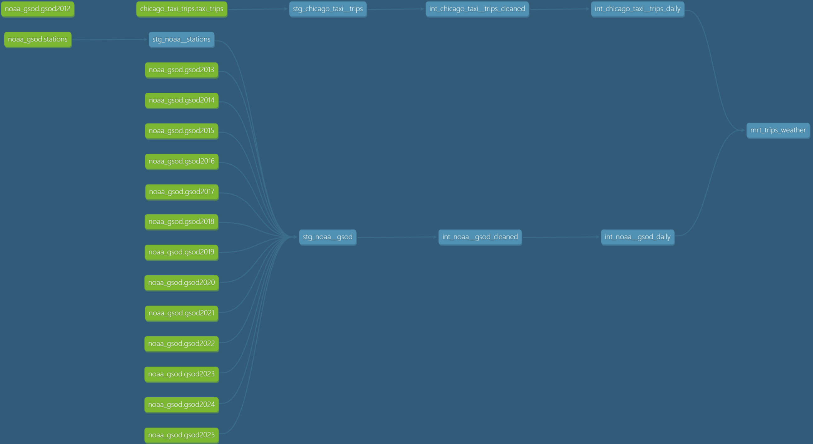

# chicago_taxi_noaa (dbt + BigQuery)

[](https://www.getdbt.com/)
[](https://cloud.google.com/bigquery)
[](LICENSE)

A dbt project on BigQuery that asks one question: **does weather affect taxi activity in Chicago?**

It joins two public datasets into a daily mart:

- `bigquery-public-data.chicago_taxi_trips.taxi_trips` (about 212M trips, roughly 80 GB, not partitioned)
- `bigquery-public-data.noaa_gsod` (one table per year, `gsod2013` ... `gsod2023`, plus a `stations` table)

## Stack

- dbt-core 1.10, dbt-bigquery 1.10
- BigQuery (billing enabled, `maximum_bytes_billed` recommended in `profiles.yml`)
- Jinja macros for dynamic year ranges (`get_taxi_year_range`, `get_noaa_years`)

## Lineage



## Design decisions

### Dynamic years across yearly source tables

GSOD stores each year in a separate table. The yearly tables are declared in `sources.yml`, and a Jinja loop over a list of years generates one `source()` call per table. Because every call goes through `source()`, dbt registers each table as a node in the DAG and lineage is preserved. The alternative (`get_relations_by_pattern`) would bypass lineage, so it is not used.

The list of years is decided by the taxi data, queried live, with no hard-coded date range per model. This is handled by two macros:

- `get_taxi_year_range()` queries min and max year from the taxi source.
- `get_noaa_years()` checks that every taxi year has a declared GSOD source and fails with a clear error if one is missing.

The macro behaves differently in two phases, which matters for lineage:

- **Parse / `dbt docs generate`** (`execute = False`): there is no warehouse connection, so the taxi query cannot run. The macro returns **all declared GSOD years**, so every `gsodYYYY` source is registered and the lineage graph is complete.
- **Run** (`execute = True`): the macro returns only the years present in the taxi data, so the union stays minimal.

If the parse phase returned an empty list, the loop would never execute and the yearly sources would appear in the docs as disconnected nodes.

### Station filter

Only stations within 30 km of downtown Chicago (`ST_DISTANCE` on `ST_GEOGPOINT`) are kept, about 20 stations. The key is the composite `stn_wban` (usaf + wban), because `stn` alone is not guaranteed unique. A `wban` of `99999` is a valid "not applicable" identifier, not a missing-value sentinel, so it is never nulled.

### Schema drift in GSOD

From 2020 onward the yearly tables contain an extra `date` column, which shifts column positions and breaks positional `UNION ALL` as well as `UNION ALL BY NAME` with `SELECT *`. The staging model selects an explicit column list and rebuilds the date from `year`, `mo`, `da`, so all years line up.

### Missing-value sentinels

GSOD encodes missing data with magic numbers (`9999.9`, `999.9`, `99.99`). They are converted to `NULL` only on measurement columns where the documentation states `Missing = X`. Where the source also provides `count_*` columns, a zero count is used to null the mean. `prcp` and `sndp` get special handling because "not reported" and "zero" are mixed into one code (see `flag_prcp` and `snow_ice_pellets` logic in `int_noaa__gsod_cleaned`).

### Station pressure parsing artifact

About 28% of post-2019 `stp` values have a dropped leading digit (for example `1013.2` becomes `13.2`). The fix adds 1000, but only where the result agrees with `slp` (sea-level pressure) within a plausible range. About 92% of affected rows are recoverable this way, the rest become `NULL`. A second pattern covering about 0.05% of rows was deliberately not chased.

### Taxi data quality

- The source contains exact duplicate rows (roughly 1.4M by `unique_key`). Staging removes them with `SELECT DISTINCT`.
- About 24% of trips report `trip_miles = 0`. This is concentrated in specific companies (Taxi Affiliation Services, Blue Ribbon, Chicago Elite Cab), not random. Where pickup and dropoff coordinates exist, distance is **reconstructed as straight-line distance**. The flag `trip_miles_was_reconstructed` marks those rows.
- Trips without `trip_total`, without a usable distance, or with null or zero `trip_seconds` are dropped.

### Daily weather aggregation

Stations disagree, and phenomena like hail or thunder are very local. So:

- continuous measures are averaged over stations that reported a value
- `max_wind_gust` and `max_snow_depth` use the maximum (the extreme in the area matters)
- binary phenomena are exposed twice: `*_any` (anywhere in range) and `*_station_ratio` (share of reporting stations)

## Known limitations

- Reconstructed distances are straight-line and systematically shorter than driven distance. Any distance vs weather analysis must control for `trip_miles_was_reconstructed`, otherwise a change in measurement method can look like a weather effect.
- Excluded and reconstructed taxi rows are not a random sample, because they cluster by company and year.
- `mrt_trips_weather` currently contains **one year only** (the current year if present in the NOAA range, otherwise the last year of the range). It is not the full history.
- The mart does not yet expose the `*_any` and `*_station_ratio` weather flags.
- `avg_precipitation` in `int_noaa__gsod_daily` is the sum divided by the number of stations with precipitation above zero, so it reflects the average over wet stations, not over all reporting stations.
- Weather values on days with few reporting stations rest on a small sample (see `station_count`).
- Straight-line reconstruction, station coverage and company-level gaps were checked on specific years; they were not re-validated for every year.

## Cost notes

- The raw taxi source is not partitioned, so any filter still scans about 80 GB. `int_chicago_taxi__trips_cleaned` is therefore built **once** and partitioned by `trip_start_timestamp`; downstream models read the smaller partitioned table.
- Use selectors (`dbt run -s <model>+`) instead of a full `dbt run` to avoid rebuilding the expensive model.
- The BigQuery sandbox (no billing) caps storage at 10 GB; this project needs billing enabled.

## Setup

1. Create a GCP project and a service account (or use OAuth) with BigQuery Data Editor, User and Job User roles. Dataset creation requires `bigquery.datasets.create` (Data Owner or Admin).
2. Configure `~/.dbt/profiles.yml` with the correct `project`, `dataset` and `method`.
3. Install dependencies and run:

```bash
pip install dbt-bigquery
dbt debug
dbt run -s int_chicago_taxi__trips_cleaned   # expensive, run once
dbt run
dbt test
```

## Materialization config

```yaml
models:
  chicago_taxi_noaa:
    +database: chicago-taxi-noaa
    staging:
      +materialized: view
      +schema: stg
    intermediate:
      +materialized: table
      +schema: int
    mart:
      +materialized: table
      +schema: mrt
```

## Maintenance: when the taxi data gets a new year

The build fails on purpose if the taxi data contains a year without a GSOD source. To fix it:

1. Add `gsodYYYY` to `_src_noaa_gsod.yml`.
2. Extend `available_noaa_years` in `macros/get_noaa_years.sql`.

Both lists must stay in sync, otherwise lineage and validation drift apart.

## Possible next steps

- Extend the mart to the full multi-year range and add the `*_any` / `*_station_ratio` flags
- Add `dbt_utils.unique_combination_of_columns` tests on (`stn_wban`, `date`) in staging
- Add an analysis layer: trips and distance vs temperature, precipitation, snow depth and fog, split by reconstructed vs reported distance
- Model-level checks on station coverage per day

## License

MIT, see [LICENSE](LICENSE).
